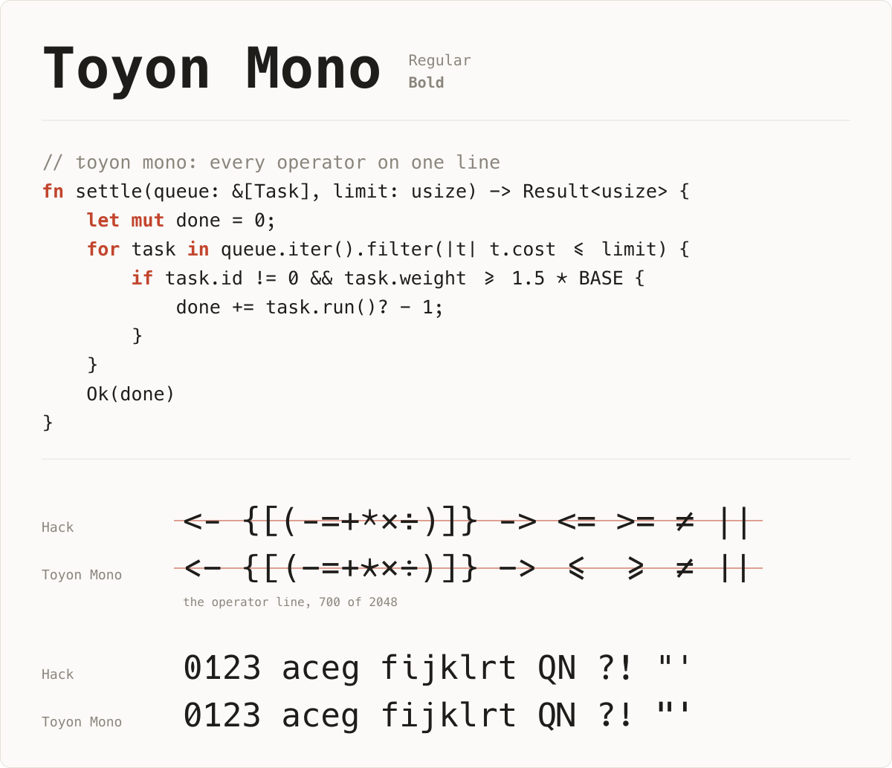

# Toyon Mono



Toyon Mono is the monospaced font of the [Toyon](https://toyon.dev) app. It is built from
[Hack](https://github.com/source-foundry/Hack), which is DejaVu Sans Mono with some glyphs
redrawn for code. Toyon Mono puts most of the redrawn letters back to DejaVu's drawing and draws
its own operators, brackets and punctuation. It has two weights, Regular and Bold.

## Use

The fonts are in `fonts/`.

- `ToyonMono-Regular.ttf` and `ToyonMono-Bold.ttf`: install these on your machine.
- `toyon-mono-regular.woff2` and `toyon-mono-bold.woff2`: serve these on the web.

```css
@font-face {
  font-family: "Toyon Mono";
  font-weight: 400;
  src: url("toyon-mono-regular.woff2") format("woff2");
}
@font-face {
  font-family: "Toyon Mono";
  font-weight: 700;
  src: url("toyon-mono-bold.woff2") format("woff2");
}
```

In CSS, a weight of 500 resolves to Regular and 600 to Bold.

`<=` and `>=` are ligatures, and the `t` in the word toyon has its own shape. Both use the
`calt` feature. In an editor or terminal, turn on the ligature setting to see them. To turn them
off in CSS, set `font-variant-ligatures: no-contextual`.

The fonts are not hinted. They are built for macOS and browsers.

## Differences from Hack

The picture shows Hack above and Toyon Mono below.

Operators and brackets:

- `- + = * < >` sit on one line, so a hyphen meets the tip of a chevron.
- `( ) [ ] { } | / \` have one height and are centred on that line.
- `- = +` and the en dash have one width.
- `< >` are narrower, taller and sharper.
- `*` is larger. `×` has the stroke of the plus.
- `{ }` have a shorter point and longer hooks.
- `_` sits on the baseline.
- The minus, division, plus-minus and not-equal signs follow the same line and width.
- `<=` and `>=` are ligatures: the chevron with a bar parallel to its lower arm. `≤ ≥` are drawn
  the same way.
- `||` and `//` are drawn closer together. Each character keeps its cell.

Letters, digits and punctuation:

- `c f g i j k l r Q 1 3 ! ? $ ( )` are DejaVu's drawing. Hack redrew them.
- `0` has a slash that ends inside the ring.
- `i j` have round dots.
- `. : ;` have dots of one size. The dots under `! ?` are smaller.
- The crossbars of `B E F H` and `e` are higher.
- `N` is wider. `1` has a longer flag. The quote marks are larger.
- In the word toyon, `t` has a slanted top and a rising tail.

## Build

Requires git, curl, unzip and [uv](https://docs.astral.sh/uv/).

```sh
./build.sh            # both weights
./build.sh Regular    # one weight: Regular or Bold
```

`fonts/` is generated by a script from Hack's sources. `build.sh` clones Hack 3.003 and
downloads DejaVu Sans Mono 2.37 into `build/`, installs fontmake there, and runs
`tools/forge.py`. That script:

1. renames the font and keeps Hack's, DejaVu's and Bitstream's notices in the name table;
2. applies `picks.json`;
3. applies the rules listed above;
4. adds the ligatures and the kerning for `||` and `//`;
5. compiles with fontmake and writes `fonts/`.

`picks.json` sets the drawing for each glyph: `dv` for DejaVu's, `hk` for Hack's, `toyon` for
Toyon's. A glyph that is not listed is Hack's. For the pairs `!=`, `->` and `<-`, `dv` leaves
the two characters as they are.

To change a glyph, edit `picks.json` or a constant in `tools/forge.py`, then run `./build.sh`.
Each constant has a comment with what it does and where the number came from.

Hack's Regular and Bold do not interpolate, so there are no weights between them.

To redraw the picture, run `build/env/bin/python tools/specimen.py` after a build.

## Licence

The Toyon changes are MIT. Hack is MIT. DejaVu's changes are in the public domain. Bitstream
Vera Sans Mono is under the Bitstream Vera licence. That licence reserves the names Bitstream
and Vera, and Hack asks that modified versions not use its name. `LICENSE.md` has the full text.
